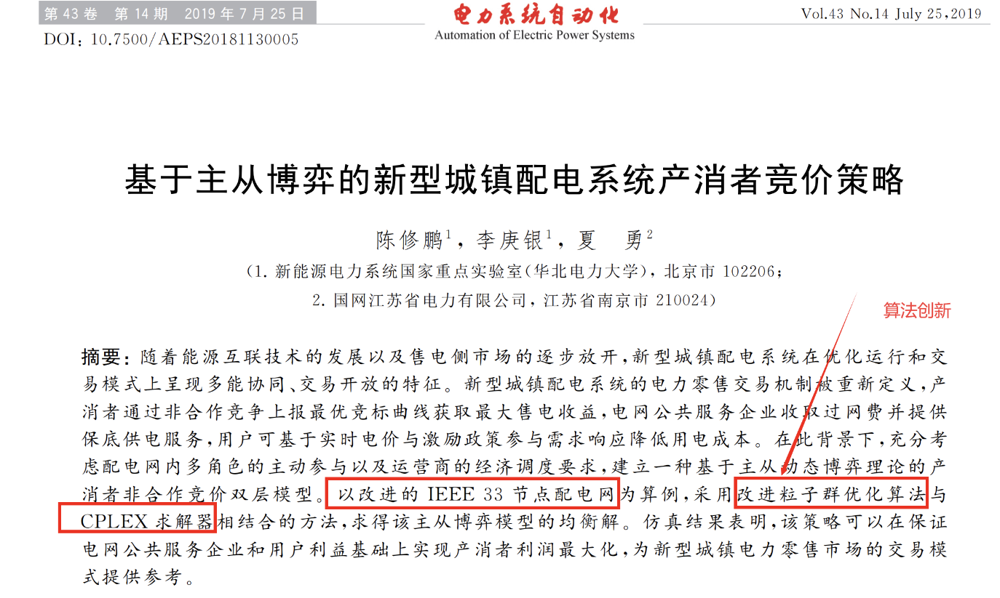

# [EI Reproduced] A New Urban Power Distribution System with Producer-Consumer Bidding Strategy Based on Master-Slave Game [IEEE33 Nodes](Matlab Code Implementation)

[EI Reproduced]New Urban Power Distribution System with Producer-Consumer Bidding Strategies Based on Master-Slave Game [IEEE33 Nodes](Matlab Code Implementation)
Reproduction:
\n        \n

## Images

<!-- PAYMENT_BLOCK -->

## Get this dataset

- Payment link (Stripe): [Buy now](https://buy.stripe.com/3cs8yP7sY87d0vu9AB)
- Payment QR code: 

<!-- /PAYMENT_BLOCK -->
